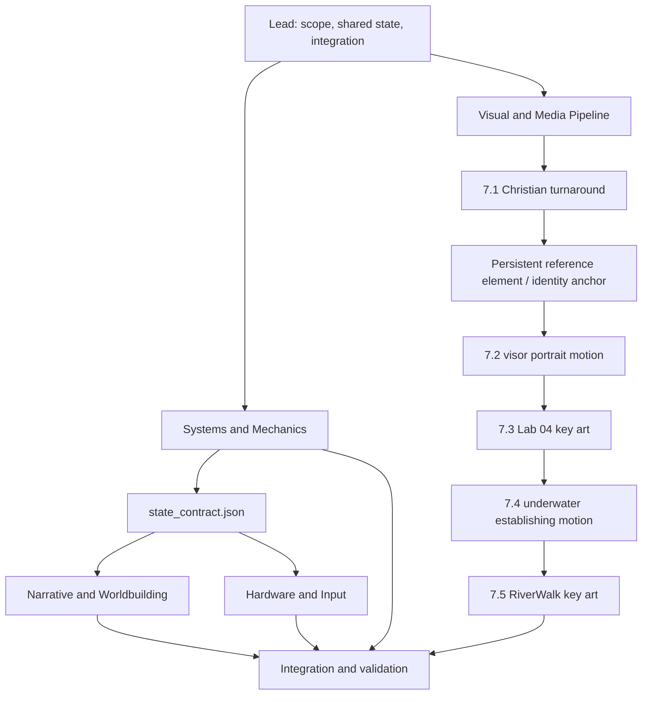

# 40 Days Under — production contract

This package translates the supplied GDD into design scripts, a deterministic reference simulation, a portable feedback adapter, and an auditable Higgsfield asset pipeline. It is not an Unreal project, a packaged macOS game, or a set of rigged game assets.

## Dependency graph

Agents own separate files. Systems publishes canonical fields and event names first; narrative and hardware consume that contract. The four specialist roles run in bounded concurrency, with the hardware role starting after a slot becomes available. Only the visual role submits media jobs, preventing duplicate paid work and accidental ordering changes.

## Decisions resolving GDD conflicts

| Topic | Production decision | Consequence |
|---|---|---|
| Habitat pressure | Lab 04 is an ambient-pressure habitat, approximately 2.5 bar absolute at its authored depth. | Living there causes fictional saturation; a one-atmosphere submarine would not support the stated clock. |
| Decompression | Preserve 17 game hours as a dramatic rule. Emergency mode compresses presentation, not a purported safe physiological procedure. | Every clock advances during accelerated gameplay; this system is never a real dive planner. |
| Pressure transfer | A sealed transfer capsule carries Christian from the decompressed lock to the shallow launch point; the capsule docks again on return. | He never opens a one-atmosphere airlock directly into water at 15 m. Travel phases abstract this equipment; its mechanics require greybox validation. |
| Air clock | Diesel supports supplied air and generation; CO2 circulation/scrubbing and oxygen availability have separate state. | Running out of fuel is a causal failure chain rather than instantaneous death. |
| Water | Label the unit “river-water treatment.” | Filtration/disinfection and power draw replace freshwater desalination terminology. |
| Food | Keep 700 meals. | Food is initially abundant; fuel, power, water handling, damage, and occupancy drive pressure. |
| Infected | Floating bodies are advected by current and trapped by obstacles. | Acoustic decoys influence mobile infected on docks; they do not make non-swimmers propel themselves through water. |
| Umbilical | Christian assembles recovered rated breathing components and an ROV tether into an authored spool system. | Wire is never presented as a breathable hose. Route length, drag, snagging, slack and retrieval need level design validation. |
| Detroit geography | Lab location, wreck and extraction marina form a fictional compressed level inspired by the east riverfront. | The 600 m extraction and 2 km trawler distances are level metrics, not surveyed navigation routes; fuel dock is fictional. |
| Perception | Hallucinations affect presentation; authoritative life-support data remains true. | Repair verification has a dependable redundant gauge and accessibility alternatives. |
| Ending | Reaching an ending freezes the run as a completed record. | “Safe and alone” means surviving the authored crisis, not obtaining infinite diesel. |

## Integration boundaries

- Simulation owns time, resource balances, branch commitments, damage and terminal state. Engine actors send validated commands; they cannot write save fields arbitrarily.
- The narrative director owns objective progression and presentation events. It reads authoritative state and gates callbacks by scene ID and objective ID.
- The feedback mixer consumes the canonical event envelope. It cannot introduce damage, input lag or hidden gameplay rules. Accessibility toggles do not change simulation difficulty.
- The persistence layer writes one complete live-or-tomb record per transaction. Production integration must handle process interruption, storage errors and platform save APIs.
- The asset manifest owns source prompts, model settings, job IDs, reference IDs, status and deviations. A reference anchor is a reproducible input dependency, not a guarantee against facial drift.

## Engine implementation gates

1. Build a greybox Lab 04 with bunk, manifold, freshwater treatment, ROV console, viewport and interlocked airlock; implement the scripted five-minute sequence.
2. Port or wrap the tested simulation with fixed-step updates; bind world-space readouts to canonical fields. Keep campaign clock acceleration distinct from animation time.
3. Implement a macOS engine input/feedback adapter for the M3 Pro MacBook target, preserving PS5/DualSense controls. Probe optional feedback capabilities and validate on the actual Mac/controller connection. No PS5 console SDK is a project requirement. See MAC_TARGET.md.
4. Author audio/haptic assets, captions, main-output fallbacks and independent accessibility controls; test them with controller channels disabled.
5. Validate the marina route, return fuel capacity, current fields, umbilical management, family occupancy and defense pressure in a playable level.
6. Convert approved visual concepts into topology, UVs, materials, rigs, animation and collision. Review Christian's face, waves, proportions, skin tone and costume across all views and shots.

## Sources used to resolve factual constraints

- [NOAA: Meet Aquarius](https://sanctuaries.noaa.gov/missions/2010aquarius/meet_aquarius.html): an ambient-pressure underwater habitat supports saturation diving. This establishes the habitat premise only, not our fictional decompression duration.
- [FIU: Working with Aquarius](https://environment.fiu.edu/aquarius/working-with-aquarius/): saturation permits extended residence, and habitat pressure normally matches surrounding water.
- [Michigan DNR: William G. Milliken State Park and Harbor](https://www.michigan.gov/recsearch/parks/WilliamMilliken): the park is east of downtown along the Detroit RiverWalk. The fictional fuel dock and route are not asserted to be real facilities.
- [PlayStation: PS5 Ultimate FAQ](https://blog.playstation.com/2020/11/09/ps5-the-ultimate-faq/): DualSense haptics, adaptive triggers, speaker and user intensity controls. Precise SDK calls and certified device limits require licensed documentation and hardware validation.

Consulted November 14, 2026. Numeric balances and feedback intensities in the package are authored tuning values unless explicitly identified otherwise.
