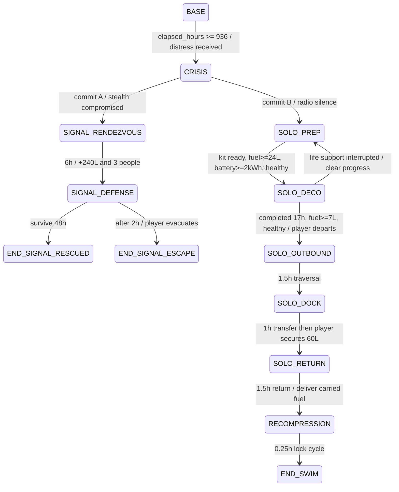

# 40 Days Under — systems implementation contract

Version 1.0. Simulation entry point: `python3 -m simulation.game`. Verification: `python3 -m unittest simulation.test_game -v`. The Python module is an executable reference and balancing harness; it is not an Unreal project, fluid solver, certified dive computer, or PS5 build. The JSON state contract is the integration boundary for narrative and hardware.

## Decisions resolving the brief

Lab 04 is an **ambient-pressure habitat**, nominally about 2.5 bar absolute at its fictional 15 m site. A one-atmosphere pressure hull would not saturate Christian merely because it is underwater. Aquarius provides a real example of ambient-pressure habitat saturation, but none of this game's timing is a real diving procedure ([NOAA Aquarius](https://sanctuaries.noaa.gov/missions/2010aquarius/meet_aquarius.html), [FIU Aquarius operations](https://environment.fiu.edu/aquarius/working-with-aquarius/)). The pressure locks and escape arrangements remain fictional engineered infrastructure requiring specialist review for a final technical art bible.

The fixed **17 game-hour** cycle is an authored survival gate. The reference model provides no gas mix, ascent schedule, depth stop, or actionable emergency decompression procedure. “Emergency protocol” means automated fault diagnosis, reserve checks and uninterrupted emergency power priority; it does not shorten the 17 hours. Upgrades reduce setup/door-cycling overhead, never this gate. Uncontrolled ascent produces a brief fictional symptom state followed by rapid damage; it is not a safe alternate shortcut.

The surface diesel plant powers fresh-air circulation and an alternator. CO₂ scrubbing is a separate electrical load with a battery reserve. Fuel exhaustion therefore stops fresh-air replenishment first; scrubber operation can temporarily continue on batteries. Hypoxia and CO₂ stress have separate states and presentations. Detroit River freshwater passes through **filtration and treatment**, not a desalination mechanic. The legacy “desalination” label can survive on a reused cabinet but must not teach the wrong process.

The 700 canned meal-equivalents are intentionally abundant for one occupant (three/day → 233 days). Food is a comfort/social resource, not a contrived day-40 starvation clock. Water production is also abundant when powered. Fuel, failed circulation, damaged hull, and risk exposure are the principal threats.

The 600 m route uses a salvaged **rated breathing umbilical assembly**, pressure regulation, protected reel, bailout abstraction and ROV-guided fuel sled. ROV wire is used for control/strain relief only; players do not manufacture breathing hose out of cable. After the fictional cycle, a **sealed one-atmosphere transfer capsule** carries Christian from the station lock at 15 m to a shallow launch point; the deep lock never opens directly onto ambient water after decompression. The capsule carries the protected reel and remains the shallow recovery point. The outbound phase abstracts this capsule transfer and the shallow corridor traversal; it does not decompress Christian, send him back to 15 m, then silently authorize another ascent. On return the capsule seals, descends, docks, and transfers Christian into the habitat airlock for fictional repressurization. Detailed capsule, breathing service, reel and route engineering is a level-design dependency; no real operating or ascent schedule is specified.

## Time, order and authority

All rates use game hours. Campaign default: one wall second advances 1/60 game hour; one game day is 24 wall minutes. Seventeen game hours therefore takes 17 wall minutes. The five-minute opening runs at a separate 1:1 override, totaling 1/12 game hour. Never use the opening override in later branch balance calculations. A host can expose a slower campaign mode, but must scale every system through the same clock. Paused menus and offline time do not advance resources.

Each update: validate delta → split at depletion and narrative deadlines → consume resources → evaluate pressure/health → apply death → evaluate branch transitions → persist → present events. Death has priority over success on the same tick. The reference integrator caps steps at one game minute and splits exactly at fuel depletion, day 40 and timed phase boundaries. Analytic exposure and linear fuel are stable across host frames; bounded stress/damage integration has a maximum one-minute discretization error and is not bit-identical across arbitrary frame partitioning. Production should run a fixed simulation cadence with an accumulated remainder and persist that remainder.

## Resource formulas and defaults

Let Δt be game hours, p occupant count, F fuel liters, B battery kWh, W water liters, M meal-equivalents. Clamp nonnegative inventories. The reference capacities are 12 kWh and 100 L water; fuel delivered by the family resides in their connected reserve tank, so it is not clamped to the small buoy tank.

| Quantity | Formula / authored value | Purpose |
|---|---|---|
| Diesel burn | `rF = 1 + 0.1 × (p − 1)` L/h; `F' = max(0, F − rF Δt)` | Nominal pump plus occupancy load |
| Initial diesel | 970 L across sealed station/buoy reserves | Day-40 decision has 34 h nominal runway |
| Solar | `Psolar = 0.1 × weather × (1 − panel_occlusion)` kW | Weather/ceiling can remove trickle power |
| Alternator | 0.55 kW while pump fueled | Shared diesel/electrical dependency |
| Demand | `0.48 + 0.04 × (p − 1)` kW | Ventilation, treatment and baseline equipment |
| Battery | `B' = clamp(B + (Psolar + Palternator − Pdemand)Δt, 0, 12)` | Powered fraction is split at depletion |
| Treatment | `20/24` L per powered hour | Default uses full reference duty; room for load shedding |
| Water consumption | `3p/24` L/h | Meals/water linkage is folded into daily baseline |
| Food consumption | `3p/24` meal-equivalents/h | 700 meals initially |
| Nitrogen exposure | `N' = 1 − (1 − N) exp(−Δt/8)` in habitat | Fictional normalized saturation only |
| Deco progress | `D' = min(17, D + Δt)` only with healthy powered support | No resource/time pause during waiting |
| Deco display load | `N = max(0, 1 − D/17)` | Deliberately conservative authored gate, not physiology |
| Hypoxia | pump off: `+Δt/3`; pump on: `−Δt/2`, clamp 0..1 | Distinct from CO₂ |
| CO₂ stress | `+unpowered_hours/2 − powered_hours/4`, clamp 0..1 | Battery scrubber grace |
| Health damage | `[80 max(0,Hypoxia−0.5) + 80 max(0,CO₂−0.4)]Δt` | Fictional lethal escalation |
| Shortage damage | empty water: 2 HP/h; empty food: 0.25 HP/h | No negative stock exploit |
| Unsafe ascent | `dcs_severity = 1`, damage `1200 × severity` HP/h | Five game minutes at 100 HP, no recovery implemented |
| Isolation | solo `+Δt/960`; family present `−Δt/48` | 0..1 presentation intensity |
| Defense hull wear | `−0.006 Δt` integrity/h | Baseline 48-hour survival leaves 71.2% hull |

The executable harness uses weather=1, panel_occlusion=0 and fixed nominal treatment duty. Weather inputs, optional high-power work, concrete sound propagation, hydrophone wildlife, interactive hull repair, stamina swimming costs, ration bonuses and individual family needs are integration extension points rather than implemented physics. The narrative and hardware contracts may emit their authored cues before these full systems exist.

Nominal fuel threshold is 15% of the starting reserve (145.5 L). Production gauges should show both liters and **remaining hours at current load**; family arrival changes the denominator. Tune a low-runway warning separately from tank percentage. External oxygen/pressure instrumentation uses actual state, while isolation can overlay a ghost readout; authoritative alarm lamps remain accurate. Accessibility can remove hallucination jitter without changing success chances.

## Act 2 branch state machine

Any nonterminal state can enter DEAD from lethal hazards. CRISIS does not pause the clock: indecision consumes the remaining fuel. Branch commitment is durable and irreversible. Solo preparation costs eight of twelve abstract salvage units, installs a rated assembly, surveys the route, prepares the acoustic decoy and installs the fuel rig. Duplicate installation cannot consume salvage twice. Optional detailed repair minigames feed the same readiness flags.

Branch A exact nominal budget: `34 − 6 + 240 − 48×1.3 = 205.6 L` after the defense. The family brings a finite 240 L allocation, not infinite fuel. The aerial sweep is a seeded narrative event, not an unexplained automatic rescue. The reference defense is an attrition baseline; authored flood, contamination and mutiny events must call validated damage/resource commands in the engine implementation. Escape requires a minimum two-hour stabilization phase; the game ends on evacuation, while a downstream sequel/save export can retain boat state.

Branch B exact nominal budget: `34 − 17 − 1.5 − 1 − 1.5 − 0.25 + 60 = 72.75 L`. The fuel sled carries 60 L; Christian does not carry that much diesel as an unsupported personal load. Completion means this chapter's return objective succeeds with approximately three further nominal days of fuel. It does not imply perpetual survival. An endless mode would resume resources from an explicit post-ending state and is outside this reference.

## River and infected behavior contract

Buoyant corpses are passive current-borne obstacles. For production, advect their positions with `dx/dt = current_field(x,t) + bounded_turbulence`, resolve shore/piling collisions, and accumulate entanglement risk by relative velocity and contact duration. Their groaning/audio can signal density; they cannot propel themselves toward the decoy. The decoy attracts mobile **shore/dock infected** within the acoustic model and buys a timed path opening. ROV sonar plus current forecast selects a route below/gaps between drifting clusters. Current reversal/eddies move the ceiling independently of player sound. Corpses must not spawn directly in a surveyed safe pocket without an upstream ingress path.

Dockside AI states: idle → investigate sound → search last known position → chase visible target → obstructed → search/idle. A splash creates an auditory stimulus, not global omniscience. Hull sounds use material transmission; underwater speaker effects must not imply human-quality underwater hearing. These spatial AI rules are specifications, not implemented in the headless state harness.

## Diegetic symptoms and hardware consumers

`dcs_severity` drives motor latency, regulator/audio distortion and visor blur, with critical gauges still legible. Optional accessibility removes input latency/blur and retains equivalent resource consequences. `pressure.unsafe_ascent` begins the symptom presentation; `health.damage` can report subsequent visible loss in the engine layer. The reference currently integrates damage in state and emits terminal failure. `co2_stress`, `hypoxia`, `stamina`, `isolation` and fuel runway are separate channels; no haptic, lightbar or hallucination feeds back into authoritative simulation.

## Permadeath and persistence

`SaveStore` uses one SQLite live slot, immutable tomb records, and immutable completed-run archives. A death transaction inserts the final tomb and removes the live slot atomically before `player.died` is emitted. Repeating the same dead save is idempotent; trying to restore an alive state for a tomb run is rejected. A completed ending is archived and frees the live slot for a new run. A different active run cannot overwrite the live slot. Stale revisions are rejected; simulation calls must run on one serialized thread. Closing/relaunching loads the last committed live state with no offline advancement.

The store prevents accidental resurrection within this implementation. It does not defeat manual file edits, external backup restoration or platform cloud-save conflict rollback. Production needs platform save APIs, a migration/version policy, crash injection coverage, cloud conflict handling, and corruption recovery that does not silently resurrect a tomb. Tombs should expose cause/time, final inventory, authored logs and a seed for derelict placement; never resume their simulation.

## Acceptance evidence

The test suite checks day-40 timing and runway; irreversible choices; finite family delivery and higher occupancy cost; the complete solo route and reserve guards; interrupted decompression; depletion partway through a tick; independent battery/air stress; paused/invalid time; death winning over ending; irregular tick deadline splitting; atomic tomb/retry/resurrection rejection; single-slot protection; completed archive/new run; malformed loaded state; and delayed unsafe-ascent symptoms. The full nominal B demo reaches END_SWIM with 72.75 L remaining.
